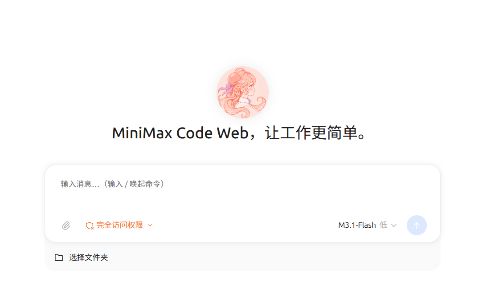
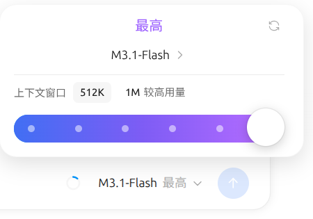
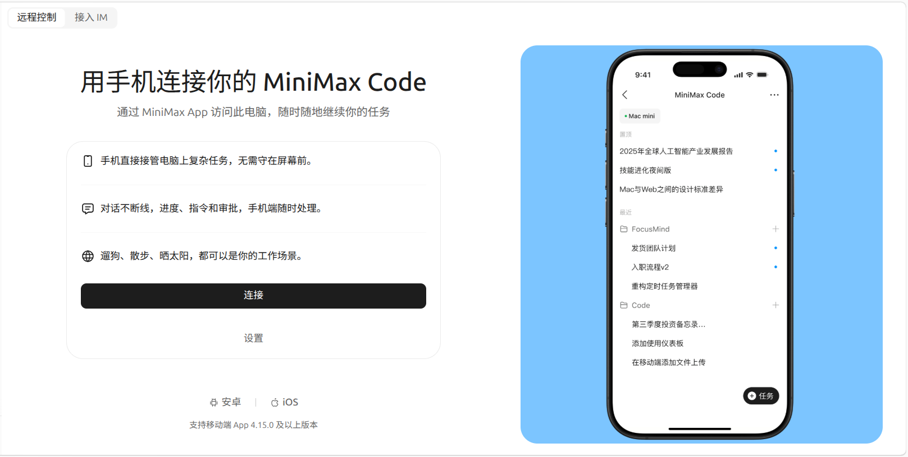
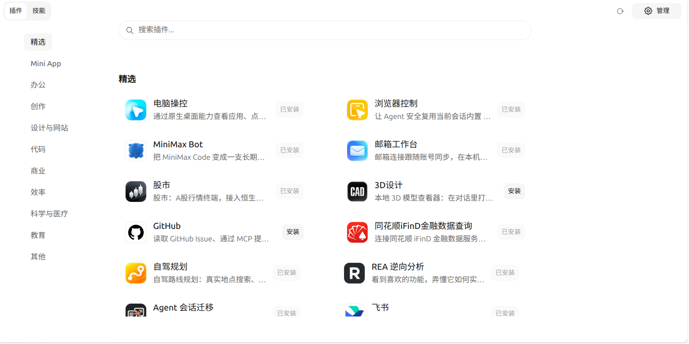

<p align="center">
  <picture>
    <source media="(prefers-color-scheme: dark)" srcset="docs/assets/wordmark-dark.svg">
    <source media="(prefers-color-scheme: light)" srcset="docs/assets/wordmark-light.svg">
    
  </picture>
</p>

<h1 align="center">MiniMax Code WebUI</h1>
<p align="center">把一句话，做成能运行的东西。用 MiniMax 或自己的模型，在浏览器里构建、审阅、继续改进。</p>
<p align="center">
  <a href="#快速开始">快速开始</a> ·
  <a href="packages/webui/README.md">使用文档</a> ·
  <a href="#可以做什么">功能介绍</a> ·
  <a href="CONTRIBUTING.md">参与贡献</a>
</p>
<p align="center"><a href="README.md">English</a> · <strong>简体中文</strong></p>
<p align="center">
  
  
  <a href="LICENSE-STATUS.md"></a>
</p>

选择项目文件夹，描述任务，在同一个浏览器工作区里跟进 Agent 的执行。把对话、文件、终端、代码变更与预览放在一起，边看结果，边继续修改。



<p align="center"><a href="#快速开始">在本地运行 →</a> · <a href="packages/webui/README.md">配置与部署 →</a></p>

**浏览器界面，本地运行时。** 服务运行在你的电脑或自行管理的机器上，浏览器连接该服务。模型调用使用你的 MiniMax 账号或已配置的模型服务，可能产生费用。本仓库是 [MiniMax Code](https://github.com/MiniMax-AI/minimax-code) 的 WebUI 分支，同时保留 TUI、无界面 CLI 和 ACP 源码。

## 快速开始

### 1. 安装 WebUI

先安装支持的 **Node.js 版本：22.19+（22.x）、24.2+（24.x）、25 或 26**，然后运行：

```bash
npm install --global @minimax-webui/minimax-code
mcode-webui
```

使用 **npm 12 及以上版本**时，需要显式允许原生依赖的安装脚本：

```bash
npm install --global @minimax-webui/minimax-code --allow-scripts=better-sqlite3,bufferutil,node-pty,utf-8-validate
```

服务默认监听 `http://127.0.0.1:2233/`，在交互式终端启动时会打开默认浏览器。如果没有自动打开，使用终端打印的地址。使用期间保持服务进程运行，按 **Ctrl+C** 停止。

以下命令可查看版本和帮助，不会启动运行时：

```bash
mcode-webui --version
mcode-webui --help
```

WebUI 使用独立的 npm 包和启动命令。上游 CLI 安装器安装的是 `mcode`；安装 WebUI 请使用上面的安装方式。

### 2. 登录账号或配置自己的模型

打开左下角账号菜单，登录 MiniMax。WebUI 与 CLI 使用同一个数据目录时，可以复用已有的 CLI 登录状态。账号模型与托管服务需要相应的账号权限及可用额度。

使用自己的模型时，进入 **设置 → 用量与模型 → 自定义模型**，添加服务商，填写接口地址与 API Key，再选择模型。支持 `openai-completions`、`openai-responses` 和 `anthropic-messages` 等 API 格式，也可以在模型设置中切换到官方 MiniMax API 来源。

在输入框中选择模型；模型支持时，还可以调整思考设置和上下文窗口：



默认数据目录为 `~/.minimax`，与 CLI 共用，保存账号状态、模型配置和会话历史。需要独立目录时，在启动服务前设置 `MINIMAX_DATA_DIR`。

### 3. 在自己的项目中使用

点击 **选择文件夹**，选择运行服务的机器上的项目，然后描述任务，例如：

> 找一个失败的测试，解释原因，修复实现，并运行相关测试。

跟进回复与工具执行，审阅文件变更，并在工作区面板中查看文件、Diff、终端和预览。在输入框中选择权限模式，控制 Agent 如何请求操作批准。

从其他电脑连接时，项目文件夹和终端都属于**运行服务的机器**。

### 继续之前的工作

在侧栏重新打开项目和对话，导入会话包，排队发送后续消息，并查看任务进度。通过 **定时任务** 创建周期性或一次性工作；定时执行期间需要保持 WebUI 运行时在线。

### 从其他设备连接

服务默认只监听本机回环地址。需要在局域网访问时：

**macOS / Linux / WSL**

```bash
WEBUI_HOST=0.0.0.0 WEBUI_OPEN_BROWSER=0 mcode-webui
```

**Windows（PowerShell）**

```powershell
$env:WEBUI_HOST = "0.0.0.0"
$env:WEBUI_OPEN_BROWSER = "0"
mcode-webui
```

打开终端打印的局域网地址，并保留本次启动生成的 token。远程使用 Mini App 时，还需要让共享 Mini App 端口可访问。完整配置见 [启动与访问示例](packages/webui/README.md#startup-examples)。

**远程** 页面还提供 MiniMax App 配对和 IM 接入，具体取决于账号及服务是否可用：



## 卸载

先按 **Ctrl+C** 停止正在运行的 WebUI，再使用安装时的同一个 npm 环境卸载：

```bash
npm uninstall --global @minimax-webui/minimax-code
```

卸载程序会保留运行时数据目录。删除数据前，请备份账号配置与会话，核对 `MINIMAX_DATA_DIR`，并确认是否有其他 CLI 或 WebUI 安装共用该目录。

## 可以做什么

| 任务 | 能力 |
| --- | --- |
| **修改并验证代码** | 让 Agent 查看项目、修改文件、运行命令与测试，并展示变更供你审阅。 |
| **结合上下文审阅工作** | 在对话旁查看文件、Diff、终端、渲染后的文档和预览。 |
| **选择自己的模型** | 使用 MiniMax 账号模型、官方 MiniMax API、自定义兼容接口及支持的 OAuth 服务，调整各模型提供的控制项。 |
| **扩展工作区** | 安装和管理插件、Skills、MCP 服务及可在浏览器运行的 Mini App。 |
| **使用浏览器工具** | 配置隔离 Chromium 或配对 Chrome/Edge 扩展；可用能力取决于所选浏览器提供方及配置。 |
| **持续推进任务** | 继续历史对话、使用子 Agent、排队发送后续消息，并创建定时任务。 |
| **远程连接** | 从浏览器访问部署在另一台机器上的 WebUI，或通过远程页面使用支持的手机与 IM 集成。 |



插件与 Mini App 可能需要特定平台能力、额外配置或外部账号。托管搜索、媒体与连接器工具需要相应的 beta 设置、授权和服务权限。当前限制见 [已知能力缺口与服务边界](packages/webui/docs/known-gaps.md)。

## 从源码构建

需要 Git、支持的 Node.js 版本以及 **pnpm 9.12.0**。Windows 上请把仓库放在本地 NTFS 卷中，并避开云同步目录。

```bash
git clone https://github.com/mcode-webui/minimax-code.git
cd minimax-code
git switch webui
node scripts/check-windows-source-location.mjs
pnpm install --frozen-lockfile
pnpm build:webui
pnpm --filter @mavis/webui dev:server
```

打开服务打印的地址，默认通过 `2233` 端口访问构建后的客户端。首次构建需要联网下载依赖和构建资源。

开发时如需客户端热更新，保持运行时服务在线，并在第二个终端运行：

```bash
pnpm dev:webui
```

打开 `http://localhost:5173/`。端口调整与本地 npm 包构建方法见 [WebUI 开发指南](packages/webui/README.md#run-from-source)。

### 配置

| 环境变量 | 默认值 | 用途 |
| --- | --- | --- |
| `WEBUI_HOST` | `127.0.0.1` | 服务监听地址。 |
| `WEBUI_SERVER_PORT` | `2233` | WebUI HTTP 与 WebSocket 端口。 |
| `WEBUI_MINIAPP_PORT` | `49152` | 共享 Mini App HTTP 与 WebSocket 端口。 |
| `MINIMAX_DATA_DIR` | `~/.minimax` | 账号、配置与会话数据目录。 |
| `WEBUI_OPEN_BROWSER` | 标准输出为终端时打开 | 设置为 `0` 可关闭自动打开浏览器。 |

安装包启动器还支持 `--full-access`，用于关闭 WebUI HTTP、WebSocket 和 Mini App 服务的 token 验证；任何能访问这些服务的人都可以使用相应的 WebUI 操作。它不改变 Agent 工具权限或监听地址。不加该参数即可保留默认 token 策略，详见 [访问选项](packages/webui/README.md#access-without-a-webui-token)。

## 文档与贡献

- [WebUI 安装、配置和运行](packages/webui/README.md)
- [WebUI 架构与技术文档](packages/webui/docs/README.md)
- [贡献指南](CONTRIBUTING.md) · [WebUI 开发规范](packages/webui/AGENTS.md)
- [上游 CLI 与共享运行时文档](docs/README.md)

英文是主要文档语言，本页与 [英文 README](README.md) 对应。贡献和审阅要求见贡献指南。

## 反馈与联系

| 渠道 | 用途 |
| --- | --- |
| [WebUI GitHub Issues](https://github.com/mcode-webui/minimax-code/issues) | WebUI 问题反馈、功能建议和使用问题。 |
| [上游 MiniMax Code](https://github.com/MiniMax-AI/minimax-code) | 上游 CLI、桌面产品信息与原项目。 |
| [安全政策](SECURITY.md) | 漏洞报告方式；请勿在公开 Issue 中披露利用细节和凭证。 |

报告 WebUI 问题时，请提供 `mcode-webui --version`、操作系统与 Node.js 版本、安装方式以及最小复现步骤。请移除凭证、账号信息与私有项目内容。

## 许可

第一方代码默认采用 [MIT](LICENSE)。现有文件级和包级许可继续保留。依赖、素材与 `mcode-tools` 的说明见 [第三方声明](THIRD_PARTY_NOTICES.md) 和 [许可状态](LICENSE-STATUS.md)。
